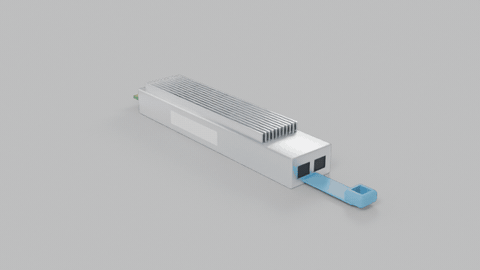

# dita-corpus

**One documentation source for six docs-and-AI projects, validated, built and measured on
every push.**

This repository is the shared sample content for a portfolio series on documentation
engineering. Every project in the series processes the same source, so a reviewer can follow
one topic from DITA through migration, drafting, retrieval, generation and compliance:

| Project | What it does with this corpus |
|---|---|
| [MANIFEST](https://github.com/siddharthraop/Manifest) | Migrates Set A to MyST docs as code and proves nothing was lost, against `build/inventory.json` |
| [The Autonomous Author](https://github.com/siddharthraop/The-Autonomous-Author) | Replays the Cloud NAT change in Set B (`nat-before-timewait` → `nat-after-timewait`) |
| [KnowledgeFlow](https://github.com/siddharthraop/KnowledgeFlow) | Joins Sets A and B through the subject scheme and relationship tables |
| [AlignR](https://github.com/siddharthraop/AlignR) | Holds out TPU7x in Set A and drafts it from the v5p and v6e siblings |
| [AEGIS](https://github.com/siddharthraop/AEGIS) | Builds regulator evidence packs from Set C |
| [VALID](https://github.com/siddharthraop/VALID) | Answers per generation, scoped by Set A's `@platform` profiling |

The content is adapted from Google's public documentation under CC BY 4.0. Google has not
engaged, sponsored or endorsed this work. See [ATTRIBUTION.md](ATTRIBUTION.md).

## What's in it

| Set | Folder | Format | Contents |
|---|---|---|---|
| A · Cloud TPU | [`tpu/`](tpu) | DITA 1.3 | 4 generations (v5e, v5p, v6e, TPU7x) × intro, specifications, configurations, VM types; a v5e slice-planning task with a `<choicetable>` and a `<hazardstatement>` (specialized on purpose); shared overview, comparison, memory, software versions, networking, a create-VM task and an OSFP media topic. 75 keys, 2 conref warehouses, `@platform` + one DITAVAL per generation, subject scheme, classification map, relationship table |
| B · Cloud NAT | [`nat/`](nat) | MyST Markdown | Overview, Tune NAT configuration, release notes. Repeated values are substitutions in `nat/conf.py`. Two tags hold the TIME_WAIT default before and after Google's 31 March 2026 change |
| C · Gemma evidence | [`gemma/`](gemma) | DITA 1.3 | 26 requirement topics (EU AI Act Annex XI Section 1, Annex XII, four NIST AI RMF subcategories), 22 evidence topics from the Gemma 4 and Gemma 3 model cards, a requirement-to-evidence relationship table with a coverage value on each link, and one DITAVAL per evidence pack |
| D · TPU API | [`api/`](api) | DITA 1.3, generated | 24 method and 54 type reference topics generated from the Cloud TPU API v2 discovery document by `tools/api2dita.py`. Do not edit by hand |
| E · Media | [`tpu/media/`](tpu/media), [`media/blender/`](media/blender) | GIF, MP4, PNG, Python | An original OSFP-style transceiver modelled and rendered headless with Blender's Python API, embedded with `<image>` (GIF for HTML, PNG for PDF via `@deliveryTarget`) and `<object>` (MP4) |



Every fact has a source, a "checked" date and a licence in
[`sources/sources.yaml`](sources/sources.yaml).

### Known issues, kept on purpose

The live pages contain real inconsistencies. The corpus keeps them, so each project has
something true to catch. Don't fix them in the source.

| ID | Issue |
|---|---|
| KI-1 | v6e HBM capacity is 32 **GB** on the v6e page and 32 in a **GiB** column on the TPU7x comparison table |
| KI-2 | TPU7x HBM bandwidth is 7380 GBps in the table and "approximately 7.37 TB/s" in the prose. `tools/validate.py` flags it (SPEC-2) |
| KI-3 | v5e HBM bandwidth is given in GiBps; every other generation uses GBps |
| KI-4 | The relationship table references platform-scoped topics with no condition, so DITA-OT still publishes them in other generations' builds (outside the TOC). MANIFEST reports it |

The TPU7x "192 GiB vs 192 GB" example used in earlier design documents was checked on
24 October 2026 and no longer appears on the live page, so it is retired.

## Where Python and lxml do the work

| Tool | What it does | lxml feature |
|---|---|---|
| [`tools/validate.py`](tools/validate.py) | Four stages: DITA 1.3 DTDs, integrity (links, conrefs of the same element type, keyrefs, subject-scheme values), house rules, source freshness | `etree` parsing and XPath; `isoschematron` for [`tools/schematron/corpus.sch`](tools/schematron/corpus.sch) |
| [`tools/api2dita.py`](tools/api2dita.py) | Discovery JSON → DITA reference topics and a key map; `--check` fails CI on spec drift | `lxml.builder.E` element factory, `tostring(doctype=…)` |
| [`tools/inventory.py`](tools/inventory.py) | Every key, conref, profiling value and reltable row, for MANIFEST's before-and-after check | tree walking |
| [`tools/extract.py`](tools/extract.py) | Per-topic analytics to CSV and BigQuery-ready NDJSON, plus the dashboard metrics with each OKR scored | `iterparse` with clearing, for flat memory on large estates |

One finding worth knowing: lxml 6 bundles libxml2 2.14, whose entity-amplification guard
rejects the OASIS DITA DTDs. Grammar validation therefore calls `xmllint` (libxml2 2.9 on
Ubuntu) with the OASIS catalog; every other check is pure lxml and needs no DTD.

## Run it locally

```sh
pip install -r requirements.txt                         # lxml, PyYAML, Sphinx, MyST
export XML_CATALOG_FILES="$(tools/fetch_grammar.sh)"    # OASIS DITA 1.3 grammars, pinned to DITA-OT 4.4.1
python tools/validate.py                                # exit 1 on any error
python tools/api2dita.py --check
python tools/inventory.py && python tools/extract.py
open dashboard/index.html                               # works straight from disk
python -m sphinx -W -b html nat out/nat                 # Set B
```

To regenerate the API reference after updating `sources/tpu-api-v2.discovery.json`, run
`python tools/api2dita.py`. To re-render the 3D media (needs `pip install bpy` and ffmpeg),
run `tools/render_media.sh`.

### In Oxygen XML Author

Open `tpu/tpu.ditamap`, `gemma/gemma.ditamap` or `api/tpu-api.ditamap` in the DITA Maps
Manager. Oxygen resolves the keys and conrefs, and **Validate and Check for Completeness**
checks the same links this repo checks in CI. To preview one generation, set the DITAVAL file
(for example `tpu/filters/tpu7x.ditaval`) as the profiling condition set.

## CI/CD

[`.github/workflows/corpus.yml`](.github/workflows/corpus.yml) runs on every push and pull
request:

1. **Validate**: all four validation stages, the API drift check, inventory and analytics, and
   the MyST build with warnings as errors.
2. **Build**: the official [DITA-OT GitHub Action](https://www.dita-ot.org/dev/topics/using-github-actions)
   builds HTML5 eight times in parallel: one per TPU generation, one per evidence pack, and the
   API reference, in strict processing mode.
3. **Publish** (main only): the outputs and the dashboard go to GitHub Pages.

## Dashboard

[`dashboard/index.html`](dashboard/index.html) shows content health against four objectives
in [`dashboard/okrs.yaml`](dashboard/okrs.yaml): every value has one source, publish at the
speed of engineering, evidence is ready for a regulator, and content is accessible and current.
The targets are the ones set for this proof of concept. Key results that are not met are
real gaps in the source, for example Annex XI evidence for Gemma 4 and two conflicting licence
statements, and the later projects close them.

## Licence

Tools and code: Apache 2.0 ([LICENSE](LICENSE)). Content adapted from Google documentation:
CC BY 4.0, modified; see [ATTRIBUTION.md](ATTRIBUTION.md). The 3D model and renders are
original work.
